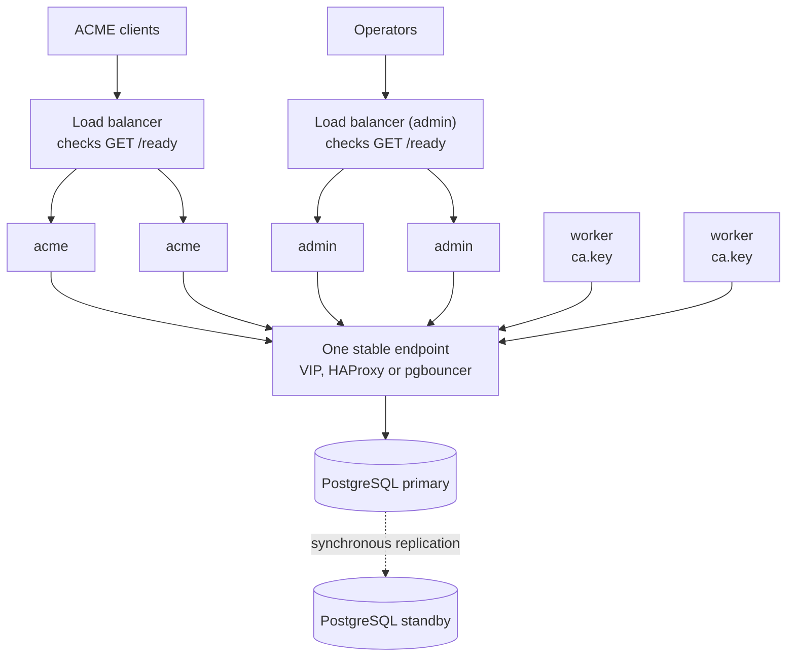

# High Availability

Several copies of each role over one PostgreSQL database, so that losing a
process or a host does not stop issuance. This page is the topology, what each
host must hold, what the load balancer checks, and how long each kind of
failure takes to recover from. It builds on [Separate Role
Processes](roles.md); read that first.

**Scope: one site.** Every process reaches **one PostgreSQL endpoint**, and
everything several processes share lives in that database ([ADR
0008](../dev/adr/0008-shared-state-in-the-database.md)). Making the database
itself highly available is PostgreSQL's job and not this server's (see
[The database](#the-database)), and so is spanning sites.

## The topology

- **`acme`, any number, behind a load balancer.** They hold no secret and keep
  no state of their own: nonces, orders, the CRL and the relay's `http-01`
  tokens are all rows, so any of them can answer any request.
- **`admin`, any number, behind a load balancer.** Sessions and the sign-in
  limiter's counters are rows too, so failed sign-ins spread over several
  admin processes spend one budget. Sessions are cookies over the database, so
  no sticky routing is needed.
- **`worker`, two or more.** They drain one job queue: a job is claimed by
  exactly one of them, and a job a dead worker held is taken over by another
  (see [Failover timings](#failover-timings)). Workers need no load balancer,
  since they have no listener.

Two processes on one host per role are no more available than one, so put each
copy of a role on a different host. A process may still run several roles;
`serve` with no `--role` runs all three.

## What every host must hold

**Initialise once, then copy.** Run `acme-proxy init` on **one** host against
the PostgreSQL database. It migrates the schema and generates the CA, the
relay's upstream account and any self-signed listener certificate. Then copy
what it made to the others:

| Material | Hosts that need it |
| --- | --- |
| `ca.pem` (each `local_ca` endpoint's `cert_path`) | every host, all roles |
| `ca.key` (`key_path`), or access to the same PKCS#11 token and key | every `worker` |
| A relay endpoint's upstream account key and its `kid` sidecar | every `worker` |
| The listener TLS certificates (`server.tls`, `admin.tls`) | every `acme` / `admin` |
| `config.toml`, identical apart from per-host addresses | every host |

**Do not run `init` on the second host.** Each run would generate its own CA.
The database records the CA each endpoint issues from, so a worker with another
CA, or with none, refuses to start rather than issuing from a second one
([Local CA → One CA per endpoint](../signers/local_ca.md#one-ca-per-endpoint)).
Use real certificates for the listeners, not the self-signed ones `init`
generates per host. Behind one name, every node must present a certificate
clients trust for that name.

## What the load balancer checks

| Path | Answers | Use it for |
| --- | --- | --- |
| `GET /ready` | `200` while the database answers within two seconds, `503` otherwise | The load balancer's health check |
| `GET /health` | `200` whenever the process accepts a connection | An orchestrator's liveness probe |

Both are on both listeners, outside the filter chains and admission control
([Monitoring](../operations/monitoring.md#readiness)). Keep the two apart. A
liveness probe that followed the database would make an orchestrator restart
every instance during a database switchover, and a restart does not bring the
database back.

A worker has no listener. Watch it through its
[metrics](../operations/monitoring.md#metrics) endpoint and its logs, and alert
on certificates no longer being issued (the suggested alerts in
[Monitoring](../operations/monitoring.md#suggested-alerts)).

## Failover timings

- **An `acme` or `admin` process dies.** The load balancer stops sending it
  requests on its next failed check. Nothing it held is lost, because it held
  nothing.
- **A worker dies.** Work it had not claimed is taken by the other workers on
  their next poll (at most
  [`jobs.poll_interval`](../configuration/reference.md#jobs)).
  A job it was running stays claimed until its lease runs out, at most
  [`jobs.lease`](../configuration/reference.md#jobs) (300 seconds by
  default), or a handler's own lease. A relay job's lease is the relay's
  [`poll_timeout`](../signers/relay.md). The next worker's pass then
  returns the job to the queue and runs it. A client polling that order sees
  `processing` for as long as that takes.
- **A job queued by one process** is picked up by a worker in another process
  at that worker's next poll, not at once: the in-process wake-up does not
  cross processes.

## The database

acme-proxy connects to **one host and port** (`database.url` takes no list of
hosts), so a PostgreSQL failover needs an address that follows the primary: a
virtual IP, HAProxy checking for the primary, or pgbouncer pointed at it. Keep
that endpoint and the cluster behind it to the tools built for them, such as
Patroni with etcd or a managed PostgreSQL. Those tools are where consensus
lives. With two sites, any of them needs a third voting member somewhere to
keep a majority when one site is lost.

During a switchover, transactions in flight fail and are answered as errors
(an ACME client retries). The pool reconnects on its own, and `/ready` answers
`503` until it has.

**Use synchronous replication.** An order row is a certificate's only record:
it is how the certificate is revoked, listed and renewed. A failover that
loses the last few commits loses certificates that were already handed out,
and leaves no way to revoke them.

SQLite is one file on one host, so none of this applies to it. It suits one
host running one process or several, and
[`acme-proxy transfer`](../operations/cli.md#moving-between-backends) moves a
deployment from SQLite to PostgreSQL.

## Upgrades

Upgrades are **not rolling**. Every worker applies the migrations when it
starts, and a process from the previous release running against the new
schema is not supported. To upgrade:

1. Stop every process, of every role, on every host.
2. Run `acme-proxy migrate` once, with the new binary.
3. Start everything again with the new binary.

[Upgrading](upgrading.md) has the rest: backups first, and why a downgrade is
a restore.

## Reloading

Each process reloads on its own `SIGHUP`, so a configuration change means
copying the file to every host and signalling every process. A reload a
process refuses leaves that process on its old configuration. Check each one's
`server_config_reloaded` line (or `server_config_reload_refused`) rather than
assuming the fleet moved together. See [Reloading the
Configuration](../operations/reload.md).

## What is not provided

- **SQLite across hosts.** Not on NFS, and not with any file-replication tool
  either.
- **Several writable databases.** There is one primary; multi-primary setups
  are not supported.
- **Spanning sites without a third voter.** Two sites cannot keep a majority
  when either one is lost, whatever replicates the data.
- **A faster job failover than the lease.** There is no lease heartbeat yet,
  so a dead worker's job waits out its lease (see above).
